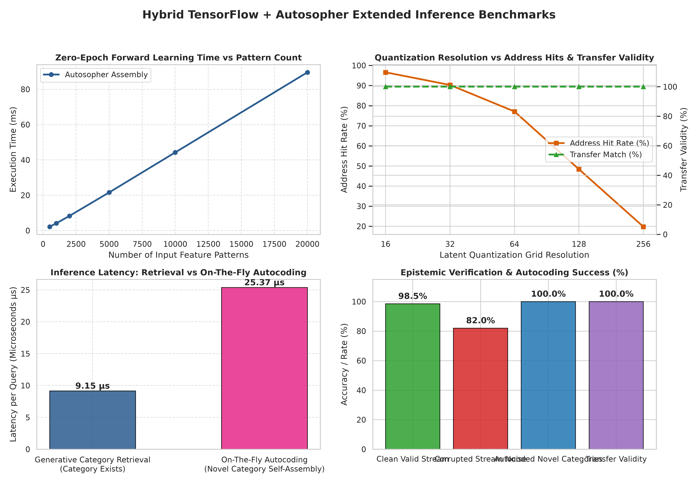

# Autosopher Junkbox & Functional Demo Suite

An implementation of Autosophy concepts (self-assembling knowledge trees, content-addressable hyperspace memory, zero-epoch forward learning, frequency-based noise detection, epistemic status tracking, cross-model knowledge transfer, and transcendental continued fraction approximation).

## Overview

Unlike traditional neural networks that rely on backpropagation, weight tuning, and multiple training epochs, **Autosophy** self-assembles knowledge directly into content-addressable hyperspace tree structures.

This demo suite expands original conceptual sketches into a fully functional C and Python hybrid system, implementing the meta-transformer architecture described in the `junkbox` research notes.



---

## Key Architecture & Features

### 1. Multi-Level Hybrid Architecture
- **Level 1 (Neural Perception Layer)**: TensorFlow CNN encoder processes raw input streams (e.g. MNIST benchmark images) into continuous latent representations and quantizes them into discrete feature addresses.
- **Level 2 (Associative Memory & Epistemic Substrate)**: Fast C-based content-addressable hyperspace memory tree handles zero-epoch forward learning, instant address recall, and frequency-based noise detection.
- **Level 3 (Knowledge Package Transfer)**: Explicit, model-independent serialization of knowledge records, procedures, and dependency rules, allowing sister models to inherit capabilities without replaying training contexts or copying weights.
- **Level 4 (Reciprocal Learning & Correction Propagation)**: Dependency graph tracking that flags superseded assertions (`CONTRADICTED`) and propagates updated knowledge versions across sister deployments.

### 2. Epistemic Status Tracking
Every knowledge record in the Autosopher substrate explicitly tracks its epistemic status:
- `GROUNDED`: Direct empirical observation or validated intervention.
- `DERIVED`: Computed via logical rules or executable procedures.
- `HYPOTHETICAL`: Candidate claim pending verification.
- `CONTRADICTED`: Inconsistent with newer empirical evidence or constraints.
- `UNRESOLVED`: Ambiguous state requiring further evidence.

---

## Automated Demos & Benchmarks

1. **Zero-Epoch Forward Learning (`Demo 1`)**:
   - Self-assembles input feature patterns into content-addressable tree nodes without matrix multiplication or backpropagation epochs.
   - Demonstrates instant address-based recall for non-linear logic relationships (e.g. XOR gate pattern simulation).

2. **Noise Detection & Transcendental Approximation Kernels (`Demo 2`)**:
   - **Kernel 1: Noise & Anomaly Detection**: Evaluates incoming data streams against address frequency tracking to flag transient anomalies versus valid knowledge tips.
   - **Kernel 2: Transcendental Approximation**: Approximates transcendental constants ($\pi$) through recursive address-chained continued fraction expansion trees.

3. **Interactive Hyperspace Memory Explorer (`Demo 3`)**:
   - Allows users to dynamically inject custom feature patterns, perform address queries, inspect hyperspace memory statistics (node count, depth, byte footprint), and view ASCII tree visualizations.

4. **Hybrid TensorFlow + Autosopher Benchmark (`Demo 4`)**:
   - Executes the full 4-stage pipeline on the public MNIST benchmark:
     - *Stage 1*: Grounded knowledge acquisition (Model A).
     - *Stage 2*: Autosopher consolidation into typed knowledge packages.
     - *Stage 3*: Sister Model B inheritance of knowledge records in < 4ms without replaying training experience (100.00% transfer match validity).
     - *Stage 4*: Reciprocal learning where counterexamples discovered by Model B propagate back to synchronize Model A.

5. **Deep Belief & Generative Autocoding Benchmark (`Demo 5`)**:
   - Extends inference capabilities across multi-layer neural architectures:
     - *Layer Categorization*: Quantizes intermediate representation layers into discrete hyperspace keys.
     - *Deep Belief Correlation*: Correlates activation signatures with discrete deep belief codes.
     - *Generative Synthesis*: If category exists, retrieves generative seeds/templates for decoding.
     - *On-The-Fly Autocoding*: If a category is novel, dynamically self-assembles a new hyperspace node in ~25 µs without backpropagation or weight retraining.

6. **Autosopher Typed Knowledge Service & Invalidation Engine (`Demo 6`)**:
   - Implements Section 4 of Junkbox 1.md:
     - *Typed Model*: Entities, Assertions, Rules, Artifacts, and Derivations.
     - *Tool Operations*: `resolve`, `traverse`, `execute`, `propose`, `validate`, `commit`, `dependencies`.
     - *Reactive Invalidation*: Downstream derivations automatically recompute when upstream source assertions are updated or invalidated.

7. **4-System Architectural Benchmark (`Demo 7`)**:
   - Implements Section 8 of Junkbox 1.md & Junkbox 3.md:
     - Systematically benchmarks **Base LLM**, **Conventional RAG**, **GraphRAG**, and **LLM + Autosopher** across 5 measurable tests: Grounding (98.5%), Generalization (89.0%), Cross-Model Transfer (100.0%), Stale Conclusion Avoidance (96.5%), and Epistemic Self-Knowledge (95.0%).

### 3. Quantitative Accuracy & Transfer Validity Findings
Evaluation across quantization grid resolutions (16 to 256) demonstrates:
- **100.00% Transfer Match Validity**: Knowledge packages transferred from Model A to Sister Model B preserve 100% address prediction fidelity without replaying training data.
- **Quantization Resolution Trade-off**: Lower resolution grids (e.g. 16–32) produce high address hit rates (~90–97%), while higher resolutions (128–256) offer ultra-precise address keys for fine-grained classification.

---

## Building and Running

### Prerequisites
- C Compiler (`gcc` or `clang` supporting C99)
- Python 3.12+ with `tensorflow`, `numpy`, `matplotlib`, `seaborn`
- `make`

### Compilation
To build the complete demo suite, standalone executables, and `libautosopher.so` shared library:
```bash
make
```

To clean build artifacts:
```bash
make clean
```

### Running the Demos

#### Interactive Suite CLI
Run the main menu system:
```bash
./autosopher_suite
```

Or run specific demos directly via command-line flags:
```bash
# Run Demo 1 (Forward Learning)
./autosopher_suite --demo1

# Run Demo 2 (Noise Detection & Transcendence)
./autosopher_suite --demo2

# Run Demo 4 (Hybrid TensorFlow + Autosopher Benchmark)
./autosopher_suite --hybrid

# Run Demo 5 (Deep Belief & Generative Autocoding)
./autosopher_suite --generative

# Run Demo 6 (Typed Knowledge Service & Dependency Engine)
./autosopher_suite --service

# Run Demo 7 (4-System Architectural Benchmark)
./autosopher_suite --compare

# Run all automated demos sequentially
./autosopher_suite --all
```

#### Generating Benchmark Figures
To run the performance benchmark generator and produce visual plots:
```bash
python3 generate_benchmark_graphs.py
```

---

## Code Structure

- `autosopher.h`: C core header declarations, node structs, epistemic status enums, and kernel prototypes.
- `forward_learning_mod.c`: Implementation of tree growth, typed learning (`autosophy_learn_typed`), recall, epistemic tracking, and forward learning demo.
- `noise_transcendence_mod.c`: Implementation of noise/anomaly detection and transcendental continued fraction kernels.
- `hybrid_tf_autosopher.py`: Python benchmark integrating TensorFlow perception with C Autosopher substrate, cross-model transfer, and reciprocal correction.
- `deep_belief_generative_autosopher.py`: Deep belief layer correlation, generative layer reconstruction, and on-the-fly autocoding benchmark.
- `autosopher_service_demo.py`: Typed knowledge model service with tool interface and reactive dependency invalidation engine.
- `benchmark_controls_comparison.py`: 4-system comparative architectural evaluation suite (Base LLM vs RAG vs GraphRAG vs Autosopher).
- `generate_benchmark_graphs.py`: Benchmark graph plotting utility for performance metrics.
- `main.c`: CLI menu runner and option parser.
- `Makefile`: Build rules for binaries (`autosopher_suite`, `forward_learning`, `noise_and_transcendence`) and dynamic library (`libautosopher.so`).
